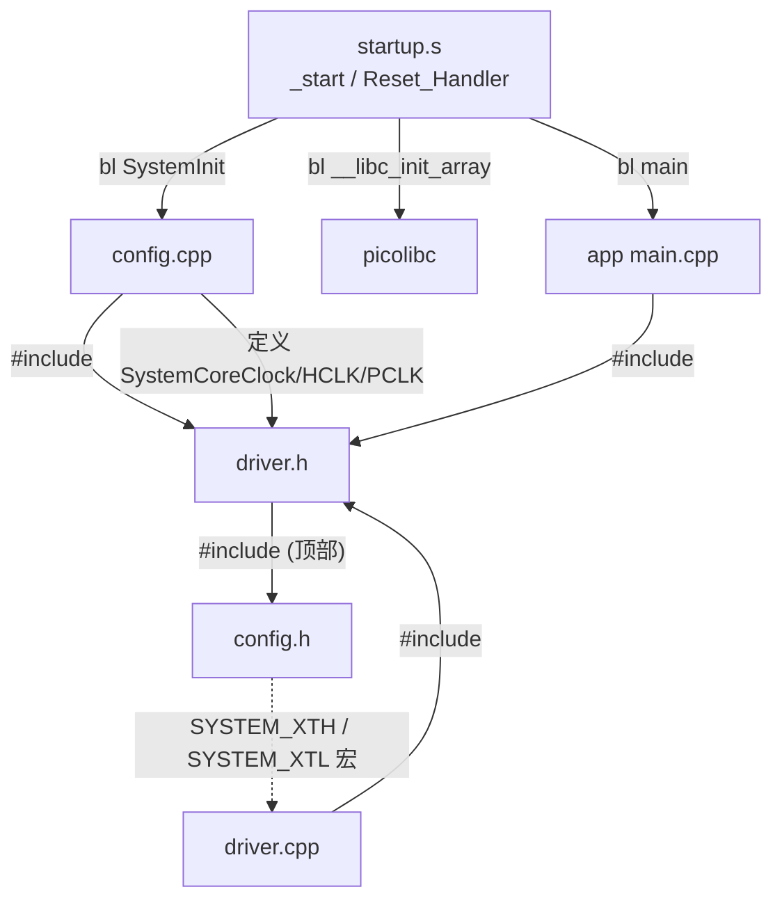

# XHSC HC32 系列 HAL 聚合移植记忆 (C++ 工程)

> 本文是"把厂商 DDL 整合成 C++ 可用 HAL"的完整方法与踩坑记录。
> 首次实施对象: **HC32A052** (Cortex-M0+, ATfE clang + picolibc)。
> 处理**其他芯片**时, 按本文 "6. 逐芯片人工核对项" 逐条过一遍即可。
>
> 相关脚本: `tools/merge_driver.py` (聚合 driver.h/driver.cpp, 可用 `--chip` 指定芯片)

---

## 1. 最终交付形态

每个 `hal/<chip>/` 目录:

| 文件 | 来源 | 维护方式 |
| --- | --- | --- |
| `driver.h` | 厂商 `driver/inc/*.h` + `mcu/common` 头文件 | **自动生成**, 勿手改 |
| `driver.cpp` | 厂商 `driver/src/*.c` + `mcu/common/interrupts_<chip>.c` | **自动生成**, 勿手改 |
| `config.h` | 厂商 `mcu/common/board_stk<chip>.h` + 手工整理 | **人工维护**: 板级配置入口 |
| `config.cpp` | 厂商 `mcu/common/system_<chip>.c` + 手工重写 | **人工维护**: 时钟初始化 |
| `startup.s` | 厂商 MDK/IAR 启动文件改写为 GNU as 语法 | 人工维护 |
| `Link.ld` | IAR `.icf` / MDK scatter 改写 | 人工维护 |

生成命令:

```bash
python3 tools/merge_driver.py                 # 默认 hc32a052
python3 tools/merge_driver.py --chip hc32f052 # 换芯片
```

脚本会打印行数与警告; **有 WARNINGS 时先看完再继续**。

---

## 2. 架构与包含方向



关键约束:

- `driver.h` **顶部** `#include "config.h"` —— 因为聚合进来的厂商 `sysctrl.c` 直接引用
  宏 `SYSTEM_XTH` / `SYSTEM_XTL` 做 PLL 校验与 `Sysctrl_GetHClkFreq` 换算。
- 所以 `config.h` **绝不能** `#include "driver.h"`, 否则循环包含。
  观察到的正确方向: `driver.h -> config.h`, `config.cpp -> driver.h`。
- `config.h` 被 `driver.h` 包含时, 厂商类型 (如 `en_flash_waitcycle_t`) **尚未声明**,
  故 `config.h` 里不能出现任何厂商类型; 枚举映射/`constexpr` 计算全放 `config.cpp`。
- `startup.s` 调用的 `SystemInit` / `SystemCoreClockUpdate` / `SystemCoreClock` 必须是
  **C 符号**, 在 `config.h` 里用 `extern "C"` 声明、在 `config.cpp` 里 `extern "C"` 定义。

---

## 3. 核心问题: C++ 名称修饰导致链接找不到符号

嵌入式里 C 语言函数符号不变, C++ 会加 `_Z` 前缀 (Itanium ABI)。把一堆原厂 `.c`
合并成一个 `.cpp` 用 C++ 编译, 会出三类问题:

### 3.1 声明缺失 → 函数变 `_Z` 修饰名

原厂有些函数/中断入口**只在 `.c` 里定义, 任何 `.h` 都没声明**。这些符号在 C 里天然是
C 符号; 合并进单个 `.cpp` 后, 若此前没有 `extern "C"` 声明, 就得到 `_Z...`。

**后果极其隐蔽**: 向量表引用的 C 符号名匹配不上, 全部落回 `startup.s` 的
`Default_Handler` —— 中断彻底失效, 但编译链接全绿无警告, Flash 还会偏小
(`--gc-sections` 把没人引用的段回收了)。

**对策**: 在 `driver.h` 的 `extern "C"` 块内补声明。脚本里两项:

- 常量 `MISSING_DECLS`(手工维护, 逐芯片不同)
- `extract_irq_symbols()` 自动从 `interrupts_<chip>.c` 提取中断入口 + 弱回调
  (正则提不到就 `SystemExit`, 绝不静默通过)

### 3.2 弱声明但无定义 → 弱未定义符号

`interrupts_<chip>.c` 里一批回调写的是 `__WEAK void Xxx_IRQHandler(void);`
—— **只有声明没有定义**, 而入口处理函数 (`SysTick_Handler` / `PORTA_IRQHandler` …)
会调用它们。这是"弱未定义符号":

- 实测 LLD 会把 `bl` 退化成相对偏移 0 (等于空操作);
- **但这是链接器实现细节**, 换链接器 / 换优化级别可能变成跳地址 0 → HardFault。

**对策**: 脚本自动为这些回调补 `__WEAK void Xxx_IRQHandler(void) {}` 空定义。
符号有定义 → 调用行为确定; 应用层写同名**强**定义即可自动覆盖 (弱定义被丢弃)。

### 3.3 校验配方 (必做)

```bash
CXX=ATfE/bin/clang++
FLAGS="--target=arm-none-eabi -mcpu=cortex-m0plus -mthumb -mfpu=none -mfloat-abi=soft \
       -std=c++26 -Wall -Wextra -Werror -Ihal/<chip> \
       -Iexternal_lib/CMSIS_6/CMSIS/Core/Include"

$CXX $FLAGS -c hal/<chip>/driver.cpp -o /tmp/driver.o
$CXX $FLAGS -c hal/<chip>/config.cpp -o /tmp/config.o

# 1) 不得有"全局" _Z 修饰符号 (小写 t/d/r 的 _ZL/_ZN12_GLOBAL 是 static, 正常)
ATfE/bin/llvm-nm /tmp/driver.o | grep -E " [TDBRWV] _Z"   # 应为空

# 2) 链接后向量表各项不能全同一个值 (否则就是全指向 Default_Handler)
ATfE/bin/llvm-objdump -s -j .isr_vector <elf> | head -8
```

---

## 4. 聚合脚本做了什么 (规则清单)

按顺序, 对每个输入文件:

1. **CRLF → LF**, UTF-8。
2. 去掉文件开头的 license / `@file` / `@brief` / change-log 大注释块。
3. 去掉 include guard (`#ifndef __X_H__` / `#define __X_H__`)。
4. 去掉各文件自己的 `#ifdef __cplusplus / extern "C" { … }` 包裹, 合并成**一层**。
5. **头文件 include 就地展开**, 用一个全局 `emitted` 集合复刻 include guard 语义:
   `ddl.h` 被 29 个头文件 `#include`, 只能真正展开一次, 否则行数从 19k 爆到 27k。
   容器注释 `/* >>> inlined from xxx.h */` 便于回溯。
6. 系统头 `<...>` 上提到文件顶部; 例外: 器件头的 `<core_cm0plus.h>` **保留原位**
   (CMSIS 依赖器件头先提供 `IRQn_Type` 与 `__NVIC_PRIO_BITS`)。
7. 丢弃 `#include "board_stk<chip>.h"` —— 内容已迁到 `config.h`
   (脚本变量 `DROPPED_INCLUDE_PREFIXES`, 默认前缀 `board_stk`)。
8. 从尾部剥掉空白 / `#endif` / 结尾注释块 (原厂文件尾有 `EOF (not truncated)`)。
9. 应用 `CPP_PATCHES` (C→C++ 兼容性补丁, 每条校验命中次数) 与 `MISSING_DECLS`。
10. 补 `__WEAK` 回调空定义 (见 3.2)。

生成的文件结构 (driver.h):

```
本文件 banner (自动生成标识 + 聚合来源)
#ifndef __<CHIP>_DRIVER_H__
CONFIG_BLOCK          -> #include "config.h" + #error 检查 SYSTEM_XTH/XTL
系统头 <...> (统一上提)
基础类型 base_types.h
CMSIS 内核配置 + IRQn_Type   (器件头前置段, 在 extern "C" 之外!)
器件寄存器 / 位定义 / 外设基址
#ifdef __cplusplus extern "C" {
  驱动核心 ddl.h + sysctrl.h
  驱动模块 (其余 28 个模块)
  中断分发框架 interrupts_<chip>.h
  中断入口/回调声明 (原厂遗漏, 补 C 链接)
  系统时钟声明 system_<chip>.h
  原厂遗漏声明补全 MISSING_DECLS
} #endif
#endif
```

---

## 5. 板级配置: config.h / config.cpp

设计目标: **换板/换时钟只改 `config.h` 一处**。

### config.h

- `SYSTEM_XTH` / `SYSTEM_XTL`: 预处理器宏, **必须存在**(厂商代码引用), 用 `#ifndef` 保护
  以便 `-D` 覆盖。
- `namespace hc32::board`: `enum class ClockSource/RchFreq/...` + `struct Config`, 数值与
  厂商 `en_sysctrl_*` **一一对应**(config.cpp 里 `static_assert` 逐项校验)。
- 若干 `inline constexpr Config` 预设, 末尾 `inline constexpr Config config = 预设;`
  一行切换。
- 板载 LED/KEY/晶振引脚宏 (来自 `board_stk<chip>.h`)。
- `extern "C"` 声明 `SystemCoreClock/SystemHCLK/SystemPCLK/SystemInit/SystemCoreClockUpdate`。

### config.cpp

- 匿名命名空间里: 枚举→厂商枚举的 `to_vendor<>()`、`constexpr` 频率推算
  (`target_hclk_hz()`)、Flash 等待周期换算 (`flash_wait_for()`)。
- `enable_xth()/enable_xtl()/enable_pll()`, 顺序与原厂示例一致。
- `SystemInit()` 顺序: RC 校准 → HCLK/PCLK 分频 → **Flash 等待周期(提速前必须设足)**
  → 使能并切换时钟源 → `SystemCoreClockUpdate()`。
- `SystemCoreClockUpdate()`: 读硬件刷新三个全局量并启动 SysTick 自由计数器。

### 时钟默认值注意

- `SystemCoreClock/HCLK/PCLK` 初值要给一个有效值(如 4 MHz), 因为
  `Sysctrl_ClkSourceEnable(SysctrlClkXTH/PLL)` 内部会用 `delay1ms/delay100us`,
  而那些延时函数读的正是 `SystemCoreClock`。
- RCH: 基频 12 MHz 经 `RCHCR.DIV` 档位 0..3 → 12/6/4/3 MHz
  (即在 `sysctrl.c` 的 `au32RCHFreqTable = {1,2,3,4}` 上做除法)。
- PLL: `Fout = (Fin / in_div) * (mul_n + mul_f/8) / out_div`;
  `in_div ∈ 1..2`, `mul_n ∈ 2..128`, `mul_f ∈ 0..7`, `out_div ∈ 4..34 偶数`。
  PLL 以 RCH 为源时厂商**固定按 12 MHz 计算**, 与 `RchFreq` 无关。
- Flash 等待周期: HCLK ≤24 MHz → 0; >24 → ≥1; >48 → ≥2。
- **没有晶振却选 Xth/Xtl/PLL(Xth) 会在 `ClkSourceEnable` 里死等** —— 默认配置务必选
  `Rch`, 无晶振板子不要乱切。

---

## 6. 逐芯片人工核对项 ★

跑脚本前/后, 逐条确认; 这些是各芯片不同、无法自动推导的部分。

| # | 位置 | 要做什么 |
| --- | --- | --- |
| 1 | `temp/` | 放好厂商 DDL 包 `HC32<XXX>_DLL_*`; 脚本自动取排序最大的一个 |
| 2 | `merge_driver.py` 顶部 `CHIP` | 或命令行 `--chip <chip>`; 推导 `DEVICE_H/IRQ_H/IRQ_C/SYS_H/SYS_C` |
| 3 | `MISSING_DECLS` | 用 §3.3 校验配方找修饰名, 反查是哪些函数缺声明, 补进 `extern "C"` |
| 4 | `CPP_PATCHES` | 常见两类: (a) `枚举变量 &= 位掩码` 复合赋值; (b) `switch` 分支未初始化就使用。每条都校验命中次数, 不匹配会报错退出 |
| 5 | `split_device_head()` 拆分锚点 | 默认在器件头 `<stdint.h>` 行后拆分(CMSIS 前置段/器件段)。器件头结构不同则改锚点 |
| 6 | `extract_irq_symbols()` 正则 | 默认匹配 `__WEAK void X(void);` 与 `void X(void)` 后跟 `{`。中断文件写法不同则改正则; 提不到会 `SystemExit` |
| 7 | `DROPPED_INCLUDE_PREFIXES` | 板级头前缀, 默认 `("board_stk",)` |
| 8 | `config.h` 枚举映射 | 对照 `sysctrl.h` 的 `en_sysctrl_*` 改 `enum class` 数值; `config.cpp` 的 `static_assert` 会兜底 |
| 9 | `config.cpp` 时钟 API | 换芯片时 `Sysctrl_*` 函数名/枚举名可能不同, 以该芯片 `sysctrl.h` 为准 |
| 10 | `startup.s` / `Link.ld` | 向量表项与 `Link.ld` 内存布局按该芯片数据手册改 |

---

## 7. 新芯片操作步骤 (checklist)

1. 把厂商 DDL 包解压到 `temp/HC32<XXX>_DLL_*`。
2. `python3 tools/merge_driver.py --chip <chip>` —— 看它报什么错:
   - `找不到厂商 DDL 目录` → 目录名不对;
   - `PATCH MISMATCH` → 原厂代码和你写的补丁不一致, 修正 `CPP_PATCHES`;
   - `中断符号提取失败` → 改正则;
   - `WARNINGS` → 一般是 `no leading banner`, 可接受但要确认。
3. 跑 §3.3 校验配方。若出现全局 `_Z`, 反查并补 `MISSING_DECLS`。
4. 写 `config.h` / `config.cpp`: 从厂商 `board_stk<chip>.h` 抄晶振频率与板级引脚;
   从 `system_<chip>.c` 抄时钟初始化流程。核对枚举数值 (抄 `sysctrl.h`)。
5. 准备 `startup.s` (GNU as 语法) 与 `Link.ld` (picolibc 符号名, `ENTRY(Reset_Handler)`,
   含 `.tdata/.tbss` 供 TLS 用)。
6. 接线 CMake (见 §9), 编译到 0 warning, 链接后查向量表各项不同。
7. 上板: 先确认 `SystemInit` 时钟正确(可用 USART 打印 `SystemCoreClock`/PCLK),
   再测中断(定时器/串口)是否真的进回调。

---

## 8. 踩过的坑 (务必避开)

- **`*/` 出现在 C 注释里会提前闭合注释**。本文件 banner 曾写
  `temp/HC32A052_DLL_*/driver`, 编译直接炸在注释中间。生成注释内容时避免 `*/` 序列。
- **include guard 必须复刻**。`ddl.h` 被 29 个头文件包含; 不用 `emitted` 集合去重,
  聚合结果会从 19k 行膨胀到 27k 行并出现重定义。
- **CMSIS 头位置**: `<core_cm0plus.h>` 必须在 `IRQn_Type` 之后, 且整个 CMSIS 前置段
  必须在 `driver.h` 的 `extern "C"` **之外** (CMSIS 核心头自带 C++ 处理)。
- **不要同时把旧 `hal/<chip>/inc/*.h` 和新 `driver.h` 放进 include path** ——
  会重复定义 `en_level_t` / `en_result_t` 等, C++ 直接报重定义。聚合方案下
  `inc/` 应当移除。
- **`mcu/common` 的 `.c` 不要再参与编译** (内容已在 `driver.cpp` / `config.cpp`),
  否则重复定义。同理 `system_<chip>.c` 的实现只能存在于 `config.cpp`。
- **`volatile` 变量自减** (`u32TimeOut--`) 在 C++20 起是 deprecated 告警。
  脚本在生成的 `driver.cpp` 里局部 `#pragma clang diagnostic ignored "-Wdeprecated-volatile"`,
  不污染用户代码。
- **删除 `_Z` 校验绝不能省**。它是最隐蔽的失效模式: 编译链接全绿, 中断却全废。
- **`--chip` 推导假设前缀是 `hc32`** (`CHIP[4:]` → `A052`)。型号命名不同要改脚本。

---

## 9. 构建接线 (cmake/config.cmake)

`select_chip(<chip>)` 里已按是否有 `driver.h` 自动区分两种 HAL 布局:

```cmake
if(EXISTS ${APP_HAL_PATH}/driver.h)          # 聚合式 (推荐)
    target_sources(hc32 PRIVATE ${APP_HAL_PATH}/driver.cpp ${APP_HAL_PATH}/config.cpp)
elseif(IS_DIRECTORY ${APP_HAL_PATH}/src)     # 逐模块式
    aux_source_directory(${APP_HAL_PATH}/src APP_ALL_SRC_3)
    target_sources(hc32 PRIVATE ${APP_ALL_SRC_3})
endif()
target_sources(hc32 PRIVATE ... ${APP_HAL_PATH}/startup.s)
```

include 目录: `${APP_HAL_PATH}`(放 driver.h/config.h) + 可选 `${APP_HAL_PATH}/inc`

### 9.1 C++ 专用编译参数 (实测有效, 别改错)

全部用生成器表达式 `$<$<COMPILE_LANGUAGE:CXX>:...>` 限定, **不能作用于 startup.s**
(汇编文件收到 C++ 开关会刷一堆 `argument unused` 告警)。

| 参数 | 实测结论 |
| --- | --- |
| `-fno-exceptions -fno-rtti` | ✅ 让 clang 从 `armv6m_soft_nofp_exn_rtti_size` 切到 `armv6m_soft_nofp_size`。driver.cpp+config.cpp 链接后 `.text 2592→2108`、`.bss 140→4`，**约省 620 字节**。用 `clang++ -print-multi-directory` 可自查 |
| `-fno-threadsafe-statics` | ✅ 裸机无并发，省掉函数内 `static` 的 `__cxa_guard_acquire/release`。验证: 链接产物 `llvm-nm \| grep __cxa_guard` 应为 0 |
| `-Werror` | ⚠️ 默认开启，但做成开关 `-DHC32_WERROR=OFF` 可关。driver.cpp 是 1.4 万行厂商代码，换编译器版本可能引入新告警 |
| `-fpermissive` | ❌ **GCC 专有**，clang 静默接受但完全无效，别写 |
| `-Wno-volatile` | ❌ **clang 无此选项**，会报 `unknown warning option`。正确写法是 **`-Wno-deprecated-volatile`** |

链接期只需同步 `-fno-exceptions -fno-rtti`（决定 multilib 目录选择）；
实测不同步也能链接成功且体积相同，但那是跨变体混链，不该依赖。

### 9.2 告警抑制要"外科手术式"限定作用域

厂商聚合代码 (driver.cpp) 与应用代码的告警标准应当**不同**:

```cmake
# 只对生成的 driver.cpp 抑制; config.cpp 与 app/ 保持全量告警
if(EXISTS ${APP_HAL_PATH}/driver.cpp)
    set_source_files_properties(${APP_HAL_PATH}/driver.cpp PROPERTIES
        COMPILE_OPTIONS "-Wno-deprecated-volatile;-Wno-unused-function;-Wno-unused-variable;-Wno-return-type;-Wno-strict-aliasing;-Wno-deprecated-declarations")
endif()
```

若把这一串 `-Wno-*` 放进 `target_compile_options`，就会连自己的应用代码也一起
屏蔽掉 `-Wunused-variable` / `-Wreturn-type` 这类**真能抓 bug** 的告警。

注意 `driver.cpp` 内部还留了一条
`#pragma clang diagnostic ignored "-Wdeprecated-volatile"`（脚本生成）。
这是**双保险**：即使有人绕过 CMake 手工编译（见 §3.3 校验配方），也不会刷告警。

---

## 10. HC32A052 实测结果 (2026-09, 作为基线)

- 输入: `driver/{inc,src}` 各 30 个 + `mcu/common/{base_types,hc32a052,interrupts_hc32a052}`。
- 产出: `driver.h` 19031 行, `driver.cpp` 14538 行 (不含手工的 config.*)。
- 中断符号提取: **41 个弱回调 + 32 个入口**(含 `HardFault_Handler` / `SysTick_Handler`)。
- `CPP_PATCHES` 4 条(sysctrl 枚举复合赋值 3 处 + usart `u32Cr3Val` 未初始化 1 处)。
- 编译: `-std=c++26 -Wall -Wextra -Werror` → **0 warning**。
- 符号: driver.o/config.o **无全局 `_Z`**; 弱回调已有定义。
- 链接 (startup.s + Link.ld + driver.o + config.o + 空 main):
  **FLASH 4340 B / RAM 1696 B**; 向量表 word0=`0x20004000`, word1=`Reset_Handler|1`,
  其余各项互不相同。
- `app/test` (USART 打印例程) 端到端构建: **FLASH 14812 B / RAM 1712 B**,
  生成 `hc32.hex` / `hc32.bin`; `clangd --check` 0 errors。
